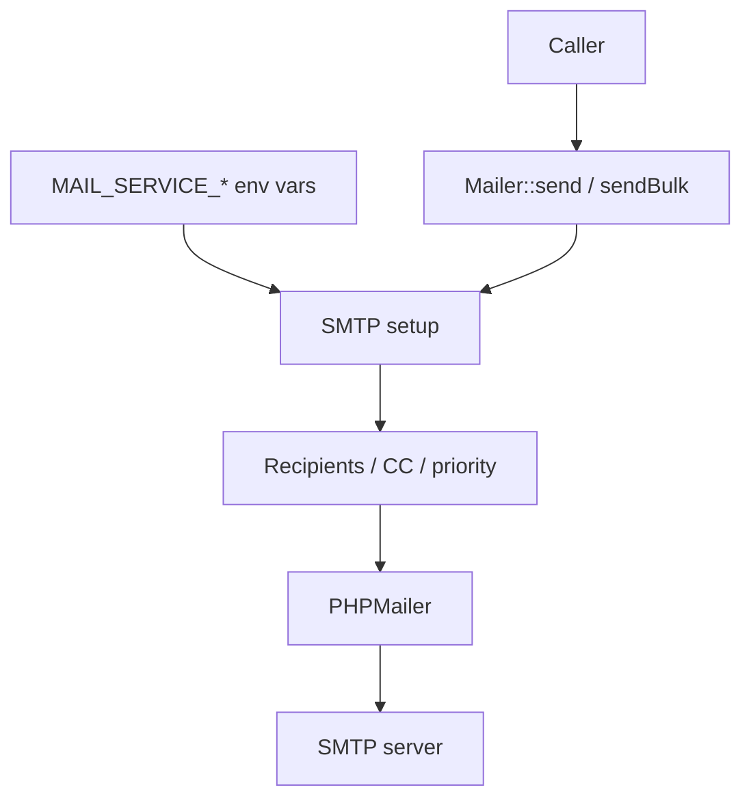

Last updated: 2026-10-25

> [!NOTE]
> This README was generated by [SKILL](https://github.com/agenvoy/skill-readme-generate), get the ZH version from [here](./doc/README.zh.md).

---

<strong>SEND SMTP MAIL IN ONE STATIC CALL!</strong>

---

> A PHP mailer library with env-based SMTP configuration, port-aware encryption, and rate-limit-friendly bulk sending

## Table of Contents

- [Features](#features)
- [Architecture](#architecture)
- [License](#license)
- [Author](#author)

## Features

> `composer require pardnchiu/mailer` · [Documentation](./doc/doc.md)

- **Environment Variables as Config** — SMTP host, credentials, port, and charset all come from environment variables, so sending takes one static call.
- **Port-Aware Encryption** — Port 465 switches to SMTPS automatically and every other port uses STARTTLS, with no encryption setting to choose.
- **Flexible Recipient Formats** — To, CC, and BCC each accept a single string, a list of addresses, or an address-to-name map.
- **Rate-Limit-Friendly Bulk Sending** — Bulk sends wait a random 1 to 3 seconds between messages to avoid tripping limits at providers like Gmail and iCloud.
- **Priority and Dual-Format Bodies** — High, normal, and low priority are supported, and HTML bodies can carry a plain-text alternative.

## Architecture

> [Full Architecture](./doc/architecture.md)

## License

This project is licensed under the [MIT LICENSE](LICENSE).

## Author

Just [open an issue](https://github.com/pardnio/php-mailer/issues/new) to share an idea.

---

©️ 2025 [邱敬幃 Pardn Chiu](https://www.linkedin.com/in/pardnchiu)
