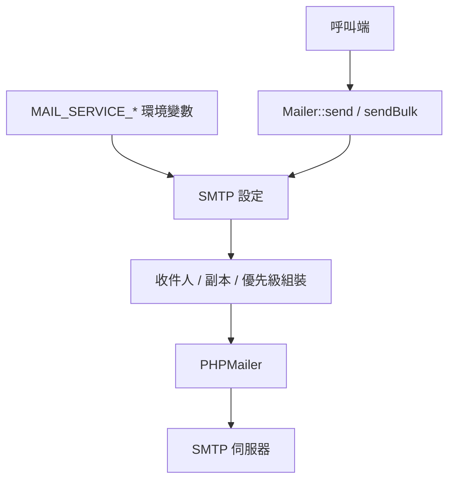

最後更新：2026-10-25

> [!NOTE]
> 此 README 由 [SKILL](https://github.com/agenvoy/skill-readme-generate) 生成，英文版請參閱 [這裡](../README.md)。

---

<strong>SEND SMTP MAIL IN ONE STATIC CALL!</strong>

---

> PHP 郵件函式庫，具備環境變數 SMTP 設定、依埠號自動加密與防限流批次寄送

## 目錄

- [功能特點](#功能特點)
- [架構](#架構)
- [授權](#授權)
- [Author](#author)

## 功能特點

> `composer require pardnchiu/mailer` · [完整文件](./doc.zh.md)

- **環境變數即設定** — SMTP 主機、帳密、埠號與編碼全部從環境變數讀取，程式端一行靜態呼叫就能寄信。
- **依埠號自動加密** — 埠號 465 自動使用 SMTPS，其餘埠號使用 STARTTLS，不必手動指定加密方式。
- **彈性收件人格式** — 收件人、副本與密件副本皆接受單一字串、地址清單或「地址對名稱」陣列。
- **防限流批次寄送** — 批次寄送時每封之間隨機間隔 1 到 3 秒，降低觸發 Gmail、iCloud 等服務限流的機率。
- **優先級與雙格式本文** — 支援高、普通、低三種優先級，HTML 本文可附帶純文字備援版本。

## 架構

> [完整架構](./architecture.zh.md)

## 授權

本專案採用 [MIT LICENSE](../LICENSE)。

## Author

Just [open an issue](https://github.com/pardnio/php-mailer/issues/new) to share an idea.

---

©️ 2025 [邱敬幃 Pardn Chiu](https://www.linkedin.com/in/pardnchiu)
