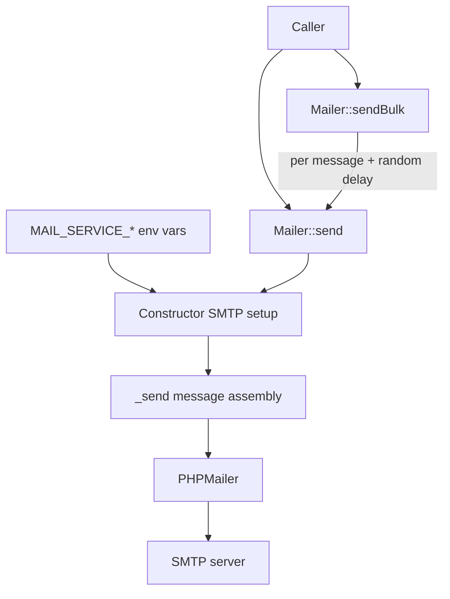
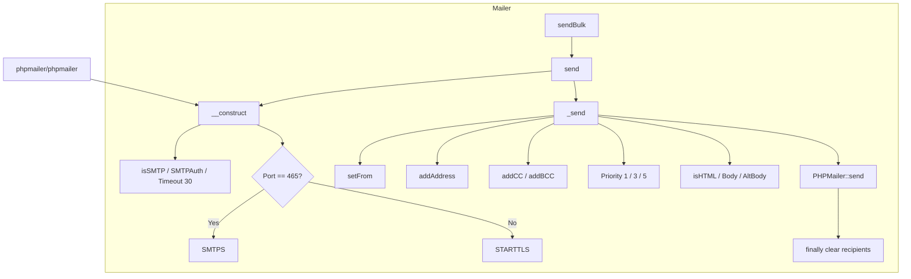
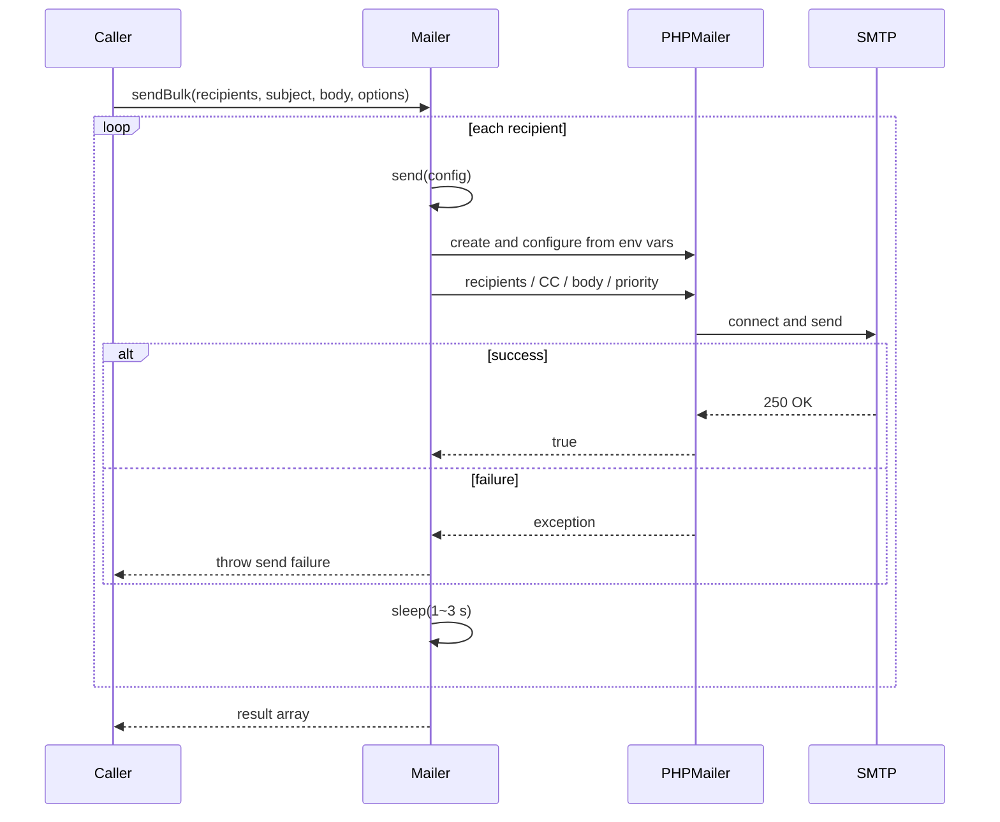

# php-mailer - Architecture

Last updated: 2026-10-25

> Back to [README](../README.md)

## Overview

## Module: Mailer

`pardnchiu\Mailer` exposes two static methods and creates a fresh PHPMailer instance for every send.

## Data Flow

***

©️ 2025 [邱敬幃 Pardn Chiu](https://www.linkedin.com/in/pardnchiu)
