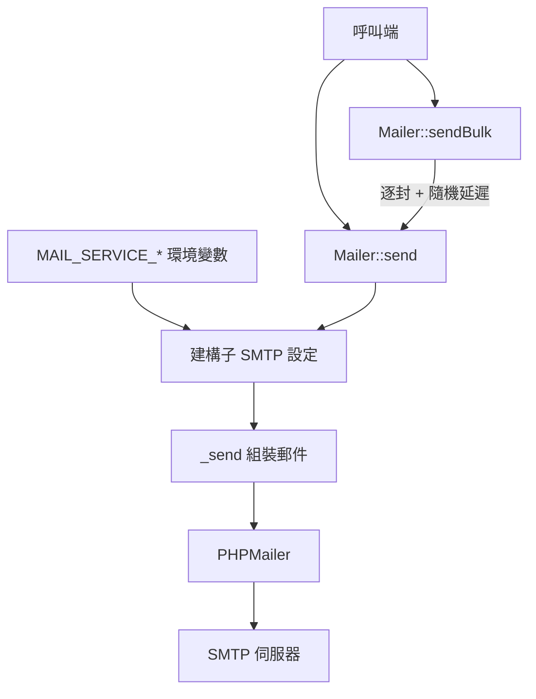
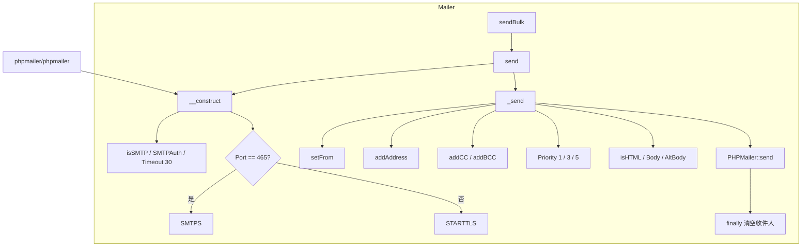
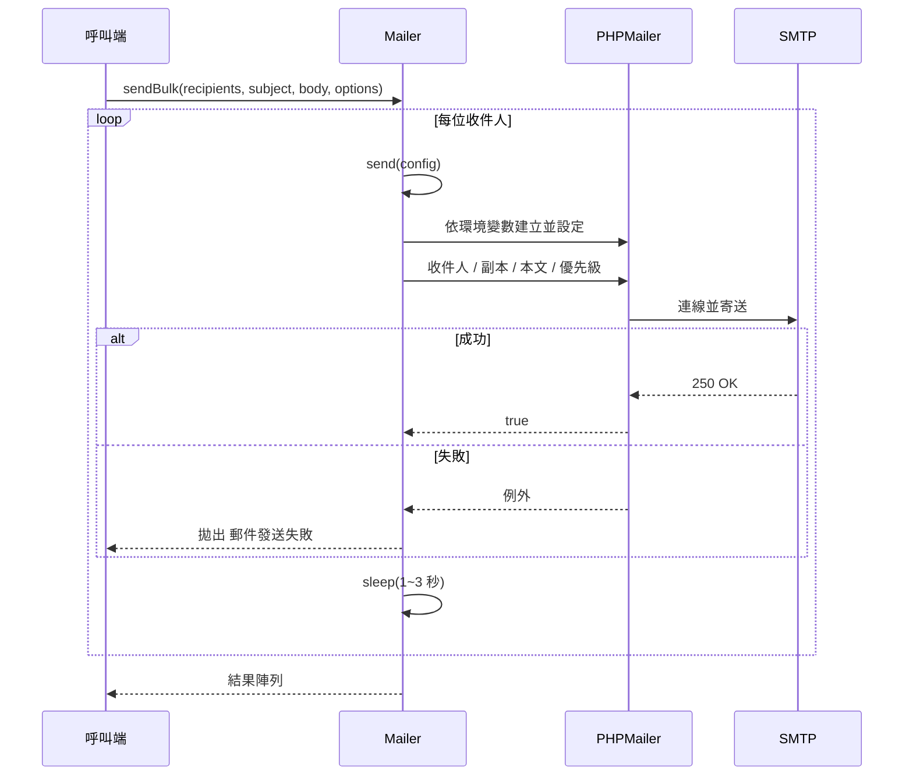

# php-mailer - 架構

最後更新：2026-10-25

> 返回 [README](./README.zh.md)

## 概覽

## Module: Mailer

`pardnchiu\Mailer` 以兩個靜態方法對外，每次寄送都建立新的 PHPMailer 實例。

## Data Flow

***

©️ 2025 [邱敬幃 Pardn Chiu](https://www.linkedin.com/in/pardnchiu)
